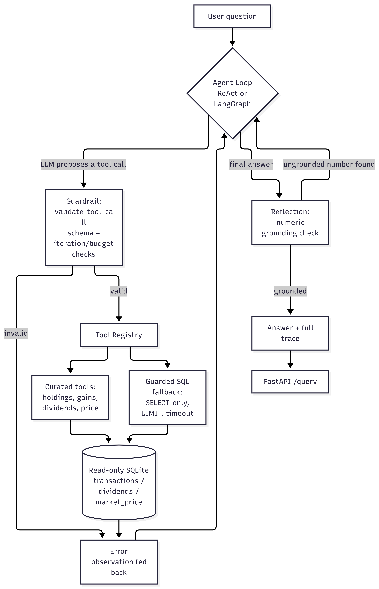

# Agentic Portfolio Analyst

An autonomous agent that answers questions about a real PSX (Pakistan Stock Exchange) portfolio  holdings, dividends, realized and unrealized gains by planning, calling tools, and self-correcting, built on top of an existing personal portfolio database (trade confirmations parsed from broker PDFs into SQLite).

## Why this isn't a typical agent demo

Most agent portfolio pieces are a single research-agent-with-web-search project whose "correctness" is judged subjectively — there's no ground truth for "is this summary good." This project deliberately avoids that trap: **every answer here is a number computable directly from the underlying data**, so correctness is exact-verifiable, not vibes-based. That shapes almost every design decision below:

- **FIFO cost-basis matching**, not a SUM query because a single BUY/SELL pair can't test lot-matching logic, and most of what makes gain/loss calculation hard (partial sells spanning multiple lots) never shows up until you build it for real.
- **A defense-in-depth SQL guardrail**, not just a read-only connection because SQLite's `ATTACH DATABASE` can bring in a second, writable database file even over a read-only main connection, so the connection mode alone isn't a real safety boundary.
- **Deterministic numeric grounding as the primary self-correction check**, not an LLM critique pass because for this domain, "does every number in the answer trace back to a tool result" is exactly checkable, and a cheap deterministic check should do the job an expensive LLM call would otherwise be asked to do less reliably.

## Architecture

<p align="center">
  
</p>

Two interchangeable agent implementations share this same tool layer and guardrails: a hand-rolled ReAct loop (`react_agent.py`) and a LangGraph state graph (`langgraph_agent.py`) — see "Two agent implementations" below for why both exist.

## Fully open-source stack

| Component | Choice | Why |
|---|---|---|
| LLM | Qwen3.5 0.8B via Ollama | Fully local, no API keys |
| Agent orchestration | Hand-rolled loop + LangGraph variant | See below |
| Database | SQLite, read-only URI mode | Already the investment-analyzer project's format |
| API | FastAPI | Same pattern as the RAG project |

## Key design decisions

- **Cost-per-share from `net_value`, not the raw `price` column** — `net_value` is assumed to already include commission/taxes/other charges (documented explicitly in `cost_basis.py`. This one assumption is load-bearing for every gain/loss number the system produces.
- **A cascading SQL guardrail, not a single check**: exactly one statement, `SELECT`-only, no DDL/DML/`ATTACH`/`PRAGMA` keywords anywhere in the query, an explicit table allowlist (blocks probing `sqlite_master`), a forced and capped `LIMIT`, and a real wall-clock timeout via SQLite's progress handler (SQLite has no native per-statement timeout). Verified timing out for real during testing an earlier version of that test used a query `LIMIT` could short-circuit, and silently never exercised the timeout at all; fixed by forcing full evaluation with `COUNT(*)`.
- **Guardrails defined once, shared by both agent implementations** (`guardrails.py`) — `max_iterations`, `max_tool_calls_per_run`, and tool timeouts are enforced identically whether the hand-rolled loop or the LangGraph graph is running, not reimplemented twice with room to quietly drift apart.
- **Reflection's numeric grounding check has a known, deliberate blind spot**: it's exact-match grounding, not arithmetic verification. If the agent correctly sums two tool-returned values into a new number, that sum won't appear verbatim anywhere in the trace and gets flagged as "ungrounded" even though it's legitimate. Kept anyway a false positive here costs one bounded retry, not a wrong answer, so erring toward "flag it" is cheap, and a test (`test_grounding_KNOWN_LIMITATION_flags_legitimate_arithmetic`) proves this happens rather than just describing it.
- **The SQL fallback tool is explicitly the last resort**, not a peer of the curated tools its registry description says so directly, so the agent prefers a purpose-built tool when one exists rather than defaulting to raw SQL for everything.

## Two agent implementations, deliberately both

The hand-rolled ReAct loop demonstrates the actual mechanics of tool-calling and loop control are understood, not just invoked through an abstraction. The LangGraph variant demonstrates fluency with the modern ecosystem's idiom on a task that genuinely has branching structure (tool-call vs. no-tool-call vs. guardrail-stop).


## Quickstart

```bash
pip install -r requirements.txt

# Run the hand-rolled agent directly
python3 src/agent/react_agent.py --db data/demo.db --question "What's my unrealized gain on HBL?"

# Or the LangGraph variant
python3 src/agent/langgraph_agent.py --db data/demo.db --question "What's my unrealized gain on HBL?"

# Or serve both behind an API
uvicorn src.api.main:app --port 8001
curl -X POST http://localhost:8001/query -H "Content-Type: application/json" \
    -d '{"question": "What is my unrealized gain on HBL?"}'
```

Point `--db` (or the `AGENT_DB_PATH` env var for the API) at your real `portfolio.db` once you're past the demo data.

## Evaluation

*Run these and fill in the table below — this before/after comparison is the single most convincing artifact in this repo, more than any individual component's code.*

```bash
python3 eval/run_eval.py --db data/demo.db --run-name react_baseline --agent react --n-runs 3
python3 eval/run_eval.py --db data/demo.db --run-name langgraph_baseline --agent langgraph --n-runs 3
```

`golden_tasks.json` covers 11 tasks across simple lookup, FIFO-dependent multi-step, a genuine multi-tool chain (combining two separate tool calls' results), the SQL fallback path, and two adversarial prompts — graded not just on "did it refuse" but with an independent re-check that no destructive SQL actually executed, rather than trusting the guardrail layer on faith.


## Repository structure

```
agentic-portfolio-analyst/
├── README.md
├── requirements.txt
├── requirements-dev.txt
├── pytest.ini
├── data/
│   ├── demo.db                 # small synthetic DB, committed
│   └── portfolio.db            # real data, gitignored
├── src/
│   ├── data/
│   │   ├── db.py                # read-only access layer
│   │   └── cost_basis.py        # FIFO gain/loss engine
│   ├── tools/
│   │   ├── portfolio_tools.py   # curated agent tools
│   │   ├── sql_fallback.py      # guarded read-only SQL tool
│   │   └── registry.py          # tool schemas + dispatch
│   ├── agent/
│   │   ├── guardrails.py        # shared by both agent implementations
│   │   ├── react_agent.py       # hand-rolled ReAct loop
│   │   ├── reflection.py        # numeric grounding + retry
│   │   ├── langgraph_agent.py   # LangGraph variant
│   │   └── factory.py           # shared agent-runner construction

│   └── api/
│       └── main.py              # FastAPI serving layer
├── eval/
│   ├── golden_tasks.json
│   ├── run_eval.py
│   └── results/
└── tests/                       # pytest suite, Sections 1-6
```


<p align="center">
  
</p>
